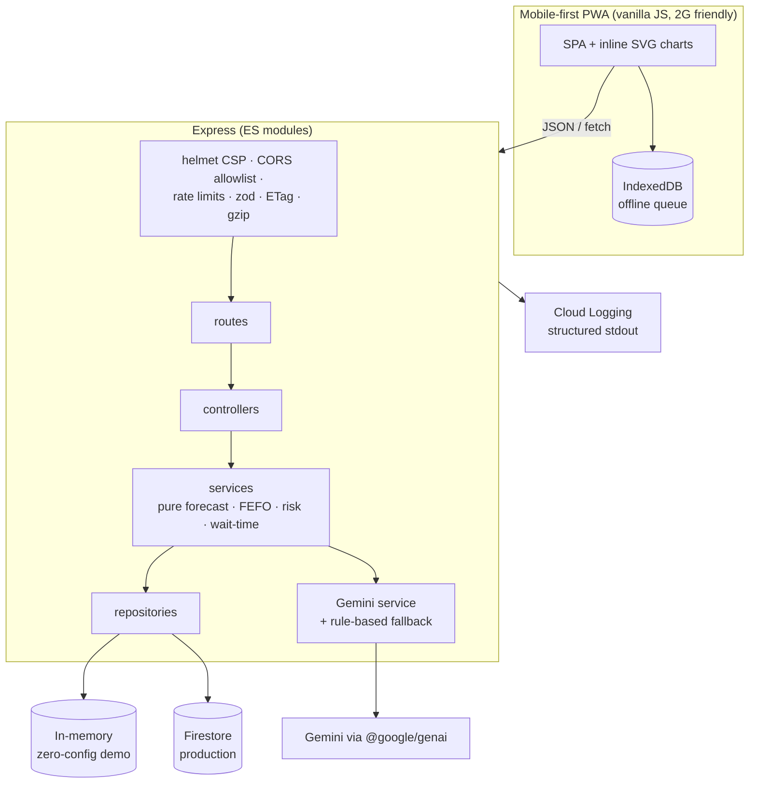

# ArogyaPulse

**AI-driven health-centre operations and district medicine supply chain for PHCs and CHCs.**

ArogyaPulse gives a Primary Health Centre one screen for the four things that actually break
rural care: medicines running out, patients waiting blind, beds that nobody can locate, and
doctors who did not turn up. It connects them to the district officer who can fix it.

Boots with **zero configuration**: in-memory repository, seeded demo district, rule-based AI.
Point it at Firestore and Gemini and the same code becomes a live deployment.

---

## The problem, and what this does about it

| Gap in the current system | What ArogyaPulse does |
|---|---|
| **Stock registers are on paper, so stock-outs are discovered when a patient is already at the counter.** | Every medicine has a batch-level record and a **deterministic** 7-day weighted moving average forecast. Each line is Red (<3 days of cover), Amber (<7) or Green, with a predicted stock-out date and a suggested reorder quantity. |
| **Nobody knows how crowded a PHC is until they arrive.** | Anonymous token queue with an hourly footfall chart, peak-hour detection from the last 14 days of the same weekday, and a **public crowding page** anyone can open before travelling. |
| **Referrals are made by phone, with no idea whether the CHC has a bed.** | One-tap bed counts per ward and referrals that show **live CHC bed availability** at the moment of referral, with a bed reserved on acceptance. |
| **Doctor absence is invisible until someone complains.** | Check-in/check-out, roster, leave, a configurable **09:30** absence alert, a 30-day reliability percentage, and a public "doctor present today" indicator. |
| **The district cannot see where the shortages are.** | District risk ranking across every facility, **auto-indent** when days-of-cover falls below threshold, and transfer suggestions that move surplus to deficit nearest-first (haversine) and redistribute stock that is about to expire. |

The entire workflow — `Requested → Approved → Dispatched → Received` — is audited. Receiving an
indent credits new batches; dispatching a transfer decrements the source batch. No unit is ever
created or destroyed by a bookkeeping step.

---

## Architecture



**Layering is enforced, not aspirational.** Routes never touch a repository; services never
touch `req`/`res`; every calculation that matters (forecast, FEFO allocation, wait estimate,
risk score, transfer suggestion) is a pure function with unit tests.

---

## Why each Google service

| Service | Why it is the right fit here |
|---|---|
| **Cloud Run** (asia-south1) | Scales to zero between OPD hours, `--min-instances=1` keeps the morning rush warm, and Mumbai region keeps latency low for Maharashtra users. No cluster to operate. |
| **Firestore** | The data is small, document-shaped and read-heavy (stock lines, tokens, wards). Native offline support, and `asia-south1` locality. Batched writes keep indents and transfers atomic-ish without a transaction budget. |
| **Gemini (`@google/genai`)** | Turns messy Hindi/Hinglish speech-style notes into structured records, and writes the daily briefing the district officer actually reads. Always with **structured JSON + schema validation**, never free text. |
| **Firebase Auth** | ID tokens verified server-side; role and facility ride as custom claims. Optional — the demo uses signed JWT cookies so nobody has to configure a tenant to see it work. |
| **Secret Manager** | The Gemini key never enters an image, a repo, or a log line. |
| **Cloud Logging** | Structured stdout JSON is picked up automatically by Cloud Run; no logging agent, no extra SDK. |

**AI never does the forecast math.** Every number — days of cover, stock-out date, wait estimate,
risk score — comes from a pure function that is unit tested. Gemini only parses language and
writes prose. That is deliberate: a hallucinated stock level would get a patient turned away.

---

## Quick start

```bash
npm install
npm start          # http://localhost:8080 - seeds a demo district on boot
npm test           # 12 suites, 224 tests
npm run lint
```

Zero configuration required. Useful environment variables (see `.env.example`):

| Variable | Default | Effect |
|---|---|---|
| `REPOSITORY` | `auto` | `auto` → Firestore when a project is set, else in-memory |
| `GOOGLE_CLOUD_PROJECT` | — | Enables Firestore |
| `GEMINI_API_KEY` | — | Enables Gemini; without it the app runs in deterministic **basic mode** |
| `SESSION_SECRET` | dev default | Signs the demo session cookie |
| `SEED_ON_BOOT` | `true` | Seeds demo data when the repository is empty |

### Demo roles

The header role switcher issues a signed cookie for a demo account:

| Role | Facility | Can do |
|---|---|---|
| `facility_staff` | PHC Rahata | stock, dispensing, tokens, beds, attendance, indents, referrals |
| `chc_admin` | CHC Sangamner | everything at the CHC, plus leave and audit |
| `district_officer` | district-wide | risk ranking, indent approval, transfers, any facility |
| `public` | read-only | crowding, beds, doctor-present indicator |

---

## Security notes

- **helmet with a strict CSP**: `default-src 'none'`, `script-src 'self'`, `object-src 'none'`,
  `frame-ancestors 'none'`. No inline script in the SPA — everything lives in one module.
- **CORS allowlist**, never `*`. **Body size caps** (64 kb JSON, 16 kb text).
- **Rate limits**: a general API bucket plus a much stricter bucket on `/api/ai/*`.
- **zod on every input**, including query strings and path params.
- **RBAC is a matrix, not `if` statements in controllers.** 28 permissions × 4 roles. A typo in a
  permission name fails *closed*.
- **The session is the only authority for tenant identity.** `facilityId` is resolved by
  middleware and injected into the validated payload; a client that sends a different facility gets
  a 403, not a silent cross-tenant write.
- **No patient PII anywhere.** Aggregate counts and anonymous tokens (`A-014`) only. Referrals carry
  a token, never a name.
- **Prompt injection**: Gemini system instructions declare `<<< >>>` delimited data as untrusted;
  every AI output is schema-validated and read-only for questions.
- **Confirm-before-save**: natural-language entry never writes. The intent is re-derived
  server-side on confirm, so a tampered client cannot claim a different intent.
- **Errors are safe**: stable codes and human-readable messages; stacks only in development, full
  detail to Cloud Logging.
- Non-root container, pinned dependencies, `.env.example` only.

---

## Efficiency

Compression and weak ETags on every JSON response · TTL caches for dashboard (15 s) and district
(30 s) aggregates, invalidated per facility on write · pagination everywhere · batched Firestore
writes · cached AI answers · lazy SPA views · multi-stage Docker image · `/healthz` · graceful
shutdown on `SIGTERM` · demo mode needs no network at all.

---

## Accessibility (WCAG 2.2 AA)

Skip link · landmark structure · `aria-live` announcements for every async result · icon **and**
text for all status (never colour alone) · ≥4.5:1 contrast · visible focus rings · full keyboard
operation · ≥44 px targets · `prefers-reduced-motion` honoured · **English/Hindi** toggle ·
large-text and high-contrast modes · tables with captions and scoped headers.

---

## Testing

```
12 suites · 224 tests
unit:        forecast, days-of-cover, FEFO allocation, wait estimate, risk, attendance,
             indent, transfers, validators, repositories, seed, utils
integration: health, headers, ETag, auth, RBAC matrix, stock/dispensing, queue, beds,
             attendance, referrals, district supply chain, AI + guardrail + fallback,
             offline replay, transfer and indent state machines
```

```bash
npm test
npm run test:coverage
```

---

## Deploy to Cloud Run

```bash
gcloud auth login
gcloud config set project YOUR_PROJECT_ID
SESSION_SECRET="$(openssl rand -hex 32)" ./deploy.sh
```

`deploy.sh` enables the APIs, creates the Artifact Registry repo, builds the image, stores the
Gemini key in Secret Manager (if `GEMINI_API_KEY` is set) and deploys to `asia-south1` with
`--allow-unauthenticated --min-instances=1 --memory=512Mi`. The equivalent single command:

```bash
gcloud run deploy arogyapulse \
  --source . --region asia-south1 --allow-unauthenticated \
  --set-env-vars NODE_ENV=production,REPOSITORY=auto \
  --set-secrets GEMINI_API_KEY=gemini-api-key:latest \
  --min-instances=1 --memory=512Mi --port 8080
```

### Post-deploy smoke checklist

1. `GET /healthz` → `{"status":"ok"}` and the expected repository.
2. Open `/` → dashboard renders with seeded cards and a briefing.
3. Switch role to **district officer** → district table lists 11 facilities.
4. **Medicines** → tap `+10` on a red line → status and cover update.
5. **Queue** → issue a token → waiting count increments.
6. **Ask** → "ORS kitna bacha hai?" → answer plus a "basic mode" or "Gemini" badge.
7. Ask a clinical question → guardrail refusal, never medical advice.
8. DevTools → Network offline → tap a stock button → "queued offline" → go online → synced.

---

## Demo script (3 minutes)

1. **0:00** — Dashboard: risk score, 10 red medicines, wait estimate. One glance, one decision.
2. **0:30** — Medicines: `−1` dispense. Watch days-of-cover fall and the status flip to Amber.
3. **1:00** — Queue: issue a token; show the hourly footfall chart and the busiest hour.
4. **1:20** — Beds + referral: open referral options → live CHC bed counts → create referral.
5. **1:45** — Doctors: check a doctor in, show "late" against 09:30 and 30-day reliability.
6. **2:15** — District: risk ranking → transfer suggestions → approve an indent through the
   workflow, then show the audit trail.
7. **2:45** — Ask: "paracetamol ke 200 tablet aaye" → preview → **confirm** → stock updated.
   Then a clinical question → refused. Close on the public crowding page.

---

## Rollout assumptions and limitations

- **Synthetic data.** The 25 medicines and 11 facilities are modelled on Maharashtra public-health
  norms but are demo data, not a real formulary.
- **`asia-south1` Firestore** is assumed; multi-district tenancy is not yet modelled (one district
  per deployment).
- **Attendance** assumes one shift per doctor per day; night duty and locum cover are out of scope.
- **Gemini is optional by design.** Basic mode is genuinely usable, which is what makes the
  zero-config demo honest.
- **No PII is stored**, so patient-level analytics (repeat visits, individual follow-up) are
  deliberately impossible.
- **Stock is facility-level**, not sub-store; a PHC with an OPD store and a labour-room store would
  need a second dimension.

## Integration roadmap

1. **ABDM / ABHA** — link tokens to health IDs only if a facility opts in, keeping aggregates PII-free.
2. **e-Aushadhi / EDL** — import the state essential-drug list and live indent numbers instead of seeded ones.
3. **SMS/IVR fallback** — the public crowding page read out over a toll-free line for feature phones.
4. **State HMIS** — push daily aggregates so the district does not double-enter.
5. **Cold-chain telemetry** — IoT temperature probes on vaccine fridges, alerting through the same alert path.

---

## License

MIT.
